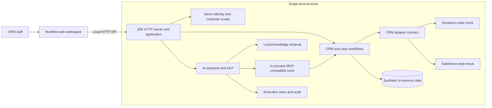

# RELASI AI


**A mock-first, offline Cognitive CRM showcase for synthetic banking workflows.**

RELASI AI is planned as an enterprise CRM demonstration combining customer and case management with AI assistance, knowledge retrieval, and controlled tool use. Its primary showcase mode is designed to run locally without a database, Docker, network access, credentials, or external systems.

> **Project status:** The local runtime, scoped Customer 360, case/interaction workflows, deterministic AI/NLP, bundled mock RAG, MCP-compatible tool workflows, and selectable CRM mock profiles are implemented. See the [development plan](docs/DEVELOPMENT_PLAN.md) for remaining work.

## What the showcase will demonstrate

- Scoped customer search and a consolidated Customer 360 profile with synthetic contacts, products, interactions, and case snapshots.
- A scoped analytics dashboard with customer and service KPIs, portfolio mix, case health, follow-up priorities, and recent activity.
- Service cases, assignments, SLA escalation, history, and customer interactions.
- A scope-limited service case queue with search, status/priority filters, and SLA attention indicators.
- Deterministic mock AI and NLP for customer service inquiries.
- Local synthetic banking knowledge retrieval with source references and abstention when evidence is missing, plus advisory next-best-action suggestions grounded in scoped customer evidence.
- MCP-compatible tool discovery and execution through an in-process registry.
- Explicit user confirmation before AI-assisted write operations.
- An inspectable AI execution trace and interchangeable Dynamics-style and Salesforce-style CRM mocks.

All banking records and payment information are synthetic. The project does not connect to real banking systems, execute payments, or require a live AI provider.

## Architecture diagram

The showcase runs as one local Java process. Its UI, API, mock CRM profiles, AI workflows, and synthetic data stay inside the application; no database, Docker, or external service is required.



## AI capabilities

- **Customer context:** Summarizes an authorized customer's profile, products, interactions, and cases from the synthetic CRM fixture set.
- **Inquiry understanding:** Classifies service intent and sentiment and extracts details from a payment complaint using deterministic local NLP.
- **Grounded knowledge answers:** Searches the bundled banking guidance, returns source references, and abstains when available evidence is insufficient.
- **Next-best-action advice:** Suggests a follow-up based on scoped customer and case evidence, with relevant guidance as support.
- **Case discovery:** Finds unresolved payment complaints visible within the selected demo user's customer scope.
- **Controlled tool use:** Discovers and invokes MCP-compatible tools; write actions require an authorized user's explicit confirmation and are audited.
- **Inspectable execution:** Shows processing steps and request identifiers to help staff understand how an answer was assembled.

All AI behavior in the default showcase is deterministic and local. Recommendations are advisory; the assistant does not execute payments or contact customers.

## Business benefits demonstrated

- **Faster service preparation:** A consolidated customer view and relationship summary reduce the effort needed to gather context before responding.
- **More consistent complaint handling:** Intent and detail extraction give staff a repeatable starting point for triage and case creation.
- **Easier access to guidance:** Cited knowledge answers help staff locate relevant procedures and see the evidence behind a response.
- **Clearer follow-up priorities:** Case aggregation and next-action suggestions surface unresolved issues for staff review.
- **Safer assisted operations:** Scope checks, human confirmation, and audit records demonstrate controls around AI-assisted changes.
- **Lower-friction evaluation:** Offline mocks and seeded data make these workflows repeatable without infrastructure or external accounts.

These are showcase benefits, not measured production outcomes.

## Quick start

Requirements: JDK 25 (both `java` and `javac`). No Maven, Node.js, database, Docker, credentials, or network connection is needed.

```sh
./run.sh
```

Open [http://127.0.0.1:8080](http://127.0.0.1:8080). The server binds to loopback only. To use another port:

```sh
RELASI_PORT=8090 ./run.sh
```

Select the CRM adapter profile with `RELASI_CRM_ADAPTER` (`DYNAMICS` by default, or `SALESFORCE`). Both profiles use the same deterministic fixture set and preserve the same canonical CRM contract and demo outcomes. `RELASI_PORT` defaults to `8080`.

The script compiles the Java sources with the JDK, bundles local resources, and starts the application. Press `Ctrl+C` to stop it. Build output is temporary and ignored by Git.

### Starter endpoints

| Endpoint | Purpose |
|---|---|
| `GET /api/v1/health` | Reports local mock runtime status. |
| `GET /api/v1/demo-users` | Lists the seeded local demo identities. |
| `GET /api/v1/session` | Returns a selected demo identity and customer scope; pass its ID in the `X-Demo-User` header. |
| `GET /api/v1/customers?q=...` | Searches customers visible to the selected demo identity; returns summary fields only. |
| `GET /api/v1/customers/{customerId}` | Returns the scoped Customer 360 profile. Unknown and out-of-scope IDs both return `404`. |
| `GET /api/v1/cases?customerId=...&status=...` | Lists cases inside the selected user's customer scope. |
| `GET /api/v1/cases/{caseReference}` | Returns case detail and event history within the user's scope. |
| `POST /api/v1/cases` | Creates a case for an in-scope customer (customer service officer, supervisor, or administrator). |
| `POST /api/v1/cases/{caseReference}/status` | Changes case status; resolving requires a resolution note. |
| `POST /api/v1/cases/{caseReference}/assignment` | Assigns an active case to a seeded service officer (supervisor or administrator). |
| `POST /api/v1/cases/{caseReference}/escalate` | Escalates an overdue active case (supervisor or administrator). |
| `GET /api/v1/interactions?customerId=...` | Lists interactions in the selected user's scope. |
| `POST /api/v1/interactions` | Records an interaction for an in-scope customer, optionally linked to that customer's case. |
| `GET /api/v1/audit` | Lists in-memory audit events (supervisor or administrator). |
| `POST /api/v1/assistant/respond` | Analyzes a natural-language request and returns a deterministic mock response, structured NLP result, and execution trace. Optional `customerId` context is scope-checked. |
| `GET /api/v1/knowledge/documents` | Lists bundled synthetic knowledge sources and chunk counts. |
| `GET /api/v1/knowledge/search?q=...` | Searches the local synthetic knowledge corpus and returns ranked passages with stable source references. |
| `GET /api/v1/tools` | Discovers in-process MCP-compatible tool definitions and JSON input schemas. |
| `POST /api/v1/tools/{toolName}` | Invokes a discovered tool using form fields defined by its schema. Write tools return a preview and actor-bound confirmation token; submit only that token to confirm. |

Write endpoints accept `application/x-www-form-urlencoded` fields. The assistant also prepares a case preview when asked with an imperative such as “Create a high-priority complaint case for this customer.” No case is created until the user confirms that exact preview. The demo identity selector is a local development convenience, not production authentication. Customer data is synthetic, deterministic, and held in memory; customer profile changes are not implemented.

Every server response includes an `X-Request-ID` header. The local console logs the request ID, method, status, and duration without logging request content; the UI includes the ID in API error messages to help locate the matching log entry.

### Demo identities

| Identity | Role | Customer scope |
|---|---|---|
| `service-officer` | Customer service officer | CUST-1001, CUST-1002 |
| `relationship-manager` | Relationship manager | CUST-1003, CUST-1004 |
| `supervisor` | CRM supervisor | All four demo customers; can reset demo data |
| `administrator` | CRM administrator | All four demo customers; can reset demo data |

The **Reset demo data** action is available to supervisors and administrators. It restores seeded cases and interactions, clears pending write confirmations, resets the audit history, then records the reset action. Data also resets when the process restarts.

### Example prompts and expected behavior

- With Alya selected, ask “Summarize this customer's relationship with the bank.” The assistant returns an in-scope Customer 360 summary.
- Ask “A transfer of IDR 2,500,000 failed yesterday.” The assistant classifies the complaint and extracts details; it does not verify or execute a payment.
- Ask “What is the procedure for handling a BI-FAST transfer complaint?” The assistant retrieves local synthetic guidance and displays its sources.
- With a customer selected, ask “Create a high-priority complaint case for this customer.” Review the preview and confirm it to create a case.
- Ask a procedure question unrelated to the bundled corpus. The assistant should abstain when no source meets the retrieval threshold.
- With Citra selected, ask “What should I do next for this customer?” The assistant prioritizes the open transfer dispute and cites synthetic product review guidance.
- Ask “Find customers who have unresolved payment complaints and summarize their cases.” The assistant returns matching customers and cases visible to the selected identity.

### Troubleshooting

- **JDK version message:** Install JDK 25 and put its `bin` directory first on `PATH`; verify `java -version` and `javac -version` both report 25.
- **Port is already in use:** Set another local port, for example `RELASI_PORT=8090 ./run.sh`.
- **Invalid CRM profile:** Use `RELASI_CRM_ADAPTER=DYNAMICS` or `RELASI_CRM_ADAPTER=SALESFORCE`.
- **No customer data appears:** Choose a seeded demo identity. The relationship manager only sees CUST-1003 and CUST-1004; the service officer sees CUST-1001 and CUST-1002.

## Intended mock-mode behavior

- CRM, LLM, NLP, payment status, identity, retrieval, audit, and tool execution use in-process mock implementations.
- Seed data is deterministic and can be restored to its initial demonstration state.
- Mutable data and audit history may reset when the application restarts.
- Safe defaults work without API keys or configuration. Optional settings will be documented in one place.
- No database, Docker, network service, or separate MCP server is part of the primary run mode.

## Documentation

- [Requirements](docs/REQUIREMENT.md) — scope, users, functional and quality requirements, and acceptance criteria.
- [Architecture (arc42)](docs/arc42.md) — target system context, building blocks, runtime flows, decisions, and risks.
- [Development plan](docs/DEVELOPMENT_PLAN.md) — milestone sequence, demo outcomes, and completion criteria.

## Demonstration scenarios

The requirements define these six repeatable scenarios. Each now has an implementation path using scoped synthetic data and local providers; automated scenario verification remains pending.

1. Summarize a customer's relationship with the bank.
2. Classify a payment complaint and extract relevant details.
3. Answer a synthetic banking procedure question with local source references, or abstain if no passage supports it.
4. Prepare and confirm creation of a service case.
5. Recommend an evidence-backed next action for a customer.
6. Find and summarize unresolved payment complaints within the user's access scope.

## Technology direction

The starter uses Java 25 and the JDK's built-in HTTP server to avoid framework downloads or build tools in the first-run path. The UI is a bundled static page. Future modules should preserve the same single-process, dependency-free run goal; see the [architecture](docs/arc42.md) and [development plan](docs/DEVELOPMENT_PLAN.md).

## Safety and scope

- Use synthetic demonstration data only.
- Enforce user and customer access scope in the application, including assistant and tool calls.
- AI recommendations remain advisory.
- A write operation requires an authorized user's explicit confirmation and is audited.
- Production banking integration, real customer data, real payment execution, and autonomous customer communication are out of scope.

