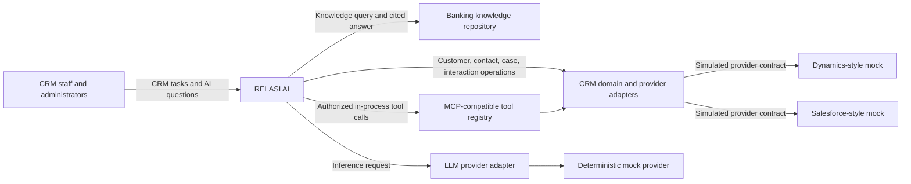
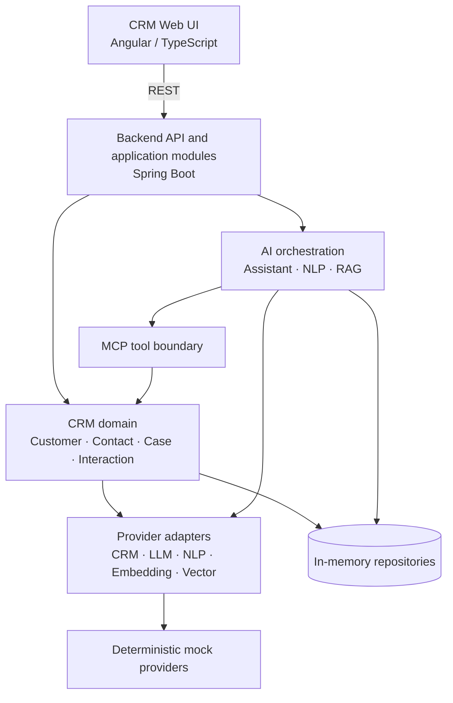
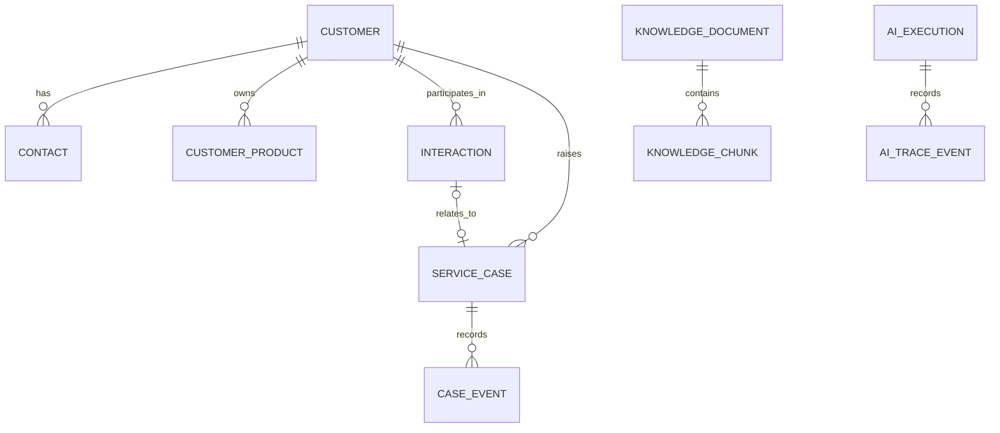
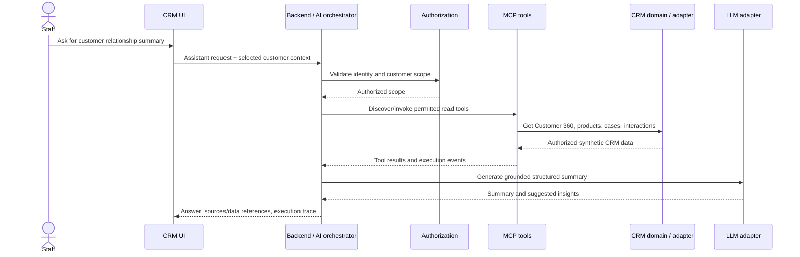
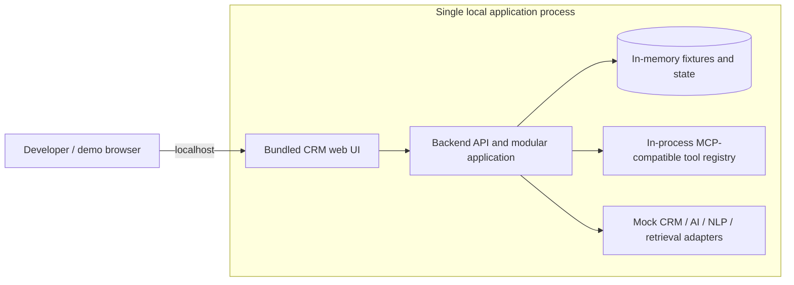

# RELASI AI — Software Architecture Documentation

> **Status:** Initial target architecture (planned; implementation has not yet established these components).
> **Source of truth:** [REQUIREMENT.md](REQUIREMENT.md)

This document follows the arc42 architecture template. It describes the intended architecture for the initial local demonstration release. Its primary run mode is self-contained: no database, Docker, network access, credentials, or external systems are required. Where the requirements leave implementation choices open, this document records a proposed baseline; those choices should be revisited as the implementation evolves.

## 1. Introduction and Goals

### 1.1 Requirements Overview

RELASI AI is a synthetic banking CRM demonstration that combines conventional customer and service operations with AI-assisted customer service and knowledge retrieval. It is intended to demonstrate secure enterprise integration and replaceable AI and CRM providers, not to operate as a production banking platform.

The most important capabilities are:

- Manage customer profiles, contacts, products, interactions, and service cases; provide a consolidated Customer 360 view.
- Assist staff with natural-language questions using authorized CRM data and banking knowledge.
- Classify intent, sentiment, and entities; retrieve and cite relevant knowledge; abstain when evidence is insufficient.
- Demonstrate MCP tool discovery and controlled invocation, including confirmation before write operations.
- Show an inspectable AI execution trace and audit relevant access and actions.
- Run offline with synthetic in-memory data and replaceable mock CRM and AI adapters, using one documented command and no database, Docker, or external systems.

### 1.2 Quality Goals

| Priority | Quality goal | Observable result |
|---|---|---|
| 1 | Security and privacy | Authenticated, role-scoped access; validated MCP inputs; masked sensitive values; synthetic data only; audited writes. |
| 2 | Explainability | AI answers show supporting knowledge sources and authorized execution traces; recommendations remain advisory. |
| 3 | Modifiability | CRM domain logic is independent of CRM vendor and AI provider implementations. |
| 4 | Demonstrability | The required CRM and AI scenarios run predictably with deterministic mock providers. |
| 5 | Operability | Local deployment, structured logs, useful errors, and graceful behavior when an AI adapter is unavailable. |
| 6 | Performance | Standard local-demo CRM API operations target a response time under 500 ms, as an initial engineering objective. |

### 1.3 Stakeholders

| Stakeholder | Interest |
|---|---|
| CRM administrator | Customer and CRM configuration, roles, and operational visibility. |
| Customer service officer / contact center agent | Customer context, case handling, interaction history, and safe AI assistance. |
| Relationship manager | Customer relationship summaries and evidence-backed next-action suggestions. |
| CRM supervisor | Case and service performance, escalation, and team productivity. |
| AI administrator | Model/provider configuration, prompts, knowledge sources, and AI operations. |
| System administrator | Deployment, integration configuration, security, audit, and observability. |
| Evaluator / developer | Understandable architecture and reproducible enterprise AI demonstrations. |

## 2. Architecture Constraints

The following constraints come from the requirements or the initial project baseline:

- Use synthetic banking data only. No production core banking, real payments, or real personal information.
- The CRM domain must remain independent of AI provider implementations.
- AI, NLP, embedding, vector search, and CRM integrations must be replaceable behind abstractions; initial providers may be deterministic mocks.
- AI recommendations are advisory. Sensitive write operations require authorization and explicit user confirmation.
- MCP tools must be discoverable, schema-defined, validated, authorized, and audited. Read and write operations must be distinguishable.
- The target baseline is Java 25 and a single local application process. A bundled UI may use Angular/TypeScript if it can be built and served without a separate runtime service. REST-style APIs and MCP-compatible schemas may be used inside the application.
- Persistent storage, Docker, external model/CRM/identity services, and a separate MCP server are not part of the primary showcase run mode. In-memory repositories, local fixtures, deterministic mock providers, and an in-process tool registry are the default.
- The expected delivery includes API and architecture documentation, conceptual data model, MCP tool specifications, synthetic data, automated tests, and demonstration scenarios. A deployed database schema is not required for the mock-only profile.
- The repository currently has a minimal Java 25 Maven project and requirements document; application code and UI are not yet present. The architecture below is therefore a proposed target, not a description of implemented behavior.

## 3. System Scope and Context

### 3.1 Business Context

**People:** CRM staff use a responsive web application to manage customer service work and invoke advisory AI capabilities. Administrators configure roles, providers, and knowledge sources.

**External systems:** The first release simulates Dynamics 365-style and Salesforce-style CRM integrations and uses mock AI providers. There is no required connection to commercial CRM, banking, or model accounts.

### 3.2 Technical Context

| Neighbor | Interaction | Boundary / trust consideration |
|---|---|---|
| Browser frontend | HTTPS/REST requests and responses to backend API | Authenticated session or bearer token; do not treat browser-supplied customer identifiers as authorization. |
| In-memory repositories | CRM, knowledge metadata, and audit state for the running demo | App-local only; seeded deterministically and resettable; state is lost at restart. |
| In-process tool registry / agent orchestration | MCP-compatible tool discovery and invocation | Only expose allowlisted tools; enforce identity, role, schema validation, and audit at the tool boundary. No separate MCP server is required for the default mode. |
| Mock CRM adapters | Shared CRM integration contract | Synthetic records; adapters must not leak vendor-specific models into domain logic. |
| AI/NLP/RAG adapters | Internal provider interfaces | Treat model output as untrusted input; constrain context and validate structured output. |
| Local runtime | Starts the UI and backend in one process | Supported Java runtime only; mock mode must work offline without credentials or service installation. |

## 4. Solution Strategy

1. Start with a modular, API-first backend. Keep customer, case, and interaction business rules in domain/application modules and isolate infrastructure behind ports and adapters. A modular monolith is the initial deployment shape; the logical modules can be split into services if demonstrated needs justify it.
2. Keep the CRM domain independent from vendor data models. Implement a shared CRM integration contract with Dynamics-style and Salesforce-style mock adapters.
3. Route AI requests through an orchestrator and provider interfaces. Deterministic mock LLM, NLP, and embedding implementations make demonstration flows reproducible.
4. Treat RAG as a traceable pipeline: ingest and chunk documents, retrieve and rank evidence, assemble bounded context, generate a response, and return source references separately from generated prose. Abstain when evidence is not adequate.
5. Place MCP tools behind an authorization and validation boundary. Mark tools read-only or write-capable; require a user confirmation step before invoking writes, then record the decision and result.
6. Make security, audit, and execution tracing cross-cutting capabilities. Apply the user's authorization scope to both direct API access and AI-mediated retrieval.
7. Use in-memory repositories and deterministic bundled fixtures as the initial persistence strategy. State resets on restart. Keep retrieval behind an interface and use local lexical or deterministic mock-vector search; no database or embedding service is required.

## 5. Building Block View

### 5.1 Level 1 — System Decomposition

The diagram is logical: these are proposed modules and interfaces, not necessarily separate deployable services. The initial repository does not yet contain these modules.

### 5.2 Level 2 — Backend Modules

| Module | Responsibility | Key interfaces / data |
|---|---|---|
| API and identity | REST boundary, authentication, authorization, request validation, API error mapping | REST resources; authenticated principal and role scope |
| Customer | Customer profile, segmentation, status, preferences, risk indicators, Customer 360 assembly | Customer and contact use cases; customer identifiers |
| Case management | Case creation, assignment, category, priority, status, SLA, history, resolution | Case commands and queries; write authorization |
| Interaction | Channel interactions and links to customers and optional cases | Interaction history query and record operations |
| Sales and campaigns | Optional lead, opportunity, campaign, response, and recommendation capabilities | Lower priority than CRM and AI foundation |
| CRM integration | Provider-neutral contracts and mapping to vendor-shaped representations | Customer/case/interaction ports; Dynamics-style and Salesforce-style adapters |
| AI assistant/orchestrator | Conversation flow, context assembly, tool selection, response generation, trace collection | Assistant request/response; trace events |
| NLP | Intent, sentiment, language, and entity extraction | Structured NLP result with confidence/evidence fields as appropriate |
| Knowledge / RAG | Document management, chunking, retrieval, ranking, prompt context, source attribution | Knowledge document/chunk and retrieval result |
| LLM / embedding / vector adapters | Provider-specific inference, embeddings, and similarity lookup | Provider-neutral interfaces and validated output |
| MCP-compatible tool registry | Tool listing, JSON schemas, invocation, access checks, result mapping, audit | In-process read-only and write tool contracts |
| Audit and observability | Security and business audit events, AI trace, structured logs, metrics | Correlation/trace identifiers; access-controlled views |

### 5.3 Domain Model (Initial)

The model is conceptual and guides in-memory repository structures for the primary showcase profile. Customer, account, payment, and transaction values are synthetic demonstration data. Authorization policy and reset behavior must be made explicit during implementation.

## 6. Runtime View

The following scenarios describe intended interactions, not verified current behavior.

### 6.1 Customer 360 Assistant

### 6.2 Knowledge Question with RAG

1. The API authenticates the staff member and validates access to the assistant capability.
2. NLP optionally classifies intent, language, sentiment, and entities; structured output is validated.
3. RAG searches indexed knowledge chunks, ranks matches, and retains document and section references.
4. The orchestrator sends the model a bounded context with instructions to distinguish evidence from inference.
5. The API returns the answer with source references and retrieval/LLM trace steps. When evidence is weak or absent, it returns an abstention or asks for clarification rather than presenting unsupported policy as fact.

### 6.3 AI-Assisted Case Creation

1. The assistant gathers customer context and drafts a structured case proposal.
2. The UI displays category, priority, description, customer, and any inferred fields for review.
3. The authorized user explicitly confirms the proposed write.
4. The backend rechecks authorization and validates all fields; the MCP write tool creates the case.
5. The result, confirmation, actor, and tool execution are audited, and the UI displays the case reference.

Confirmation must be tied to the specific reviewed proposal. A changed proposal requires a new confirmation. Model output alone never authorizes a write.

## 7. Deployment View

### 7.1 Initial Local Deployment (Target)

This is the proposed primary topology, not an existing implementation. It must start with one documented command and must not require Docker, a database, network access, credentials, or external services. If the UI needs a separate development server during development, demo startup should still serve bundled assets from the application process.

### 7.2 Environment Notes

- Local demo uses synthetic fixtures and deterministic in-process integrations by default. Include a reset-to-demo-state action; mutable state and audit history reset on restart.
- Mock mode requires no credentials. Optional configuration should use safe defaults and a small set of documented environment variables or a local config file.
- Database persistence, Docker/Compose, Kubernetes, external CRM connectivity, and regulated banking operation are outside the primary showcase run mode.

## 8. Cross-Cutting Concepts

### 8.1 Security and Authorization

- Authenticate API users with the selected JWT-based approach; define roles and permissions for CRM and AI administration.
- Authorize each customer read, case write, knowledge administration action, and MCP invocation on the server.
- Propagate the authenticated principal and permitted customer scope through AI orchestration and tool calls. Do not trust model-generated claims of authorization.
- Validate REST and MCP inputs at boundaries. Treat model outputs and retrieved documents as untrusted data.
- Mask sensitive values in UI, logs, traces, and generated context where full values are not required.
- Use synthetic data only. Do not send real customer or payment data to an external provider in this demo.

### 8.2 Write Safety and Audit

- Classify MCP tools as read-only or write-capable in their definitions and enforce the classification server-side.
- Require explicit, user-visible confirmation for sensitive write actions. Reauthorize at execution time.
- Record actor, action, target, time, confirmation, outcome, and correlation identifier for security-relevant operations.
- Keep AI recommendations advisory; a human user owns business decisions and actions.

### 8.3 AI Grounding and Traceability

- Represent retrieval evidence and generated text as distinct response fields.
- Attach stable source references to retrieved knowledge; do not fabricate citations.
- Return structured intent/entity output and validate it before downstream use.
- Capture user input, NLP result, retrieval candidates, source references, provider invocation, tool discovery/calls, outcomes, final response, duration, and correlation ID, subject to access control and data minimization.
- Provide a graceful fallback when a provider fails; do not silently claim an unavailable inference or retrieval occurred.

### 8.4 Error Handling and Observability

- Use consistent API error responses and avoid exposing stack traces or secrets.
- Emit structured logs and metrics with correlation IDs; exclude or mask unnecessary customer content.
- Track AI execution stages and durations for the authorized trace view.
- Separate provider failures, validation failures, authorization denials, and business-rule errors.

### 8.5 Persistence and Integration Boundaries

- Keep persistence mappings and vendor-specific DTOs out of domain use cases.
- Use explicit interfaces for CRM, LLM, NLP, embedding, and vector search implementations.
- Version external-facing REST and MCP schemas as they become public contracts.
- Load deterministic synthetic fixtures and provide a reset-to-demo-state operation.

## 9. Architecture Decisions

| ID | Decision | Rationale / consequence | Status |
|---|---|---|---|
| ADR-01 | Begin as a modular monolith with API-first boundaries | Fits the small demonstration repository and keeps modules separable without imposing distributed deployment overhead. | Proposed |
| ADR-02 | Keep CRM and AI providers behind domain-owned interfaces | Allows mock-to-real provider replacement without changing business logic. | Required by requirements; implementation pending |
| ADR-03 | Use deterministic mocks for initial inference and integrations | Enables repeatable scenarios without external accounts or network dependencies. | Required for initial AI provider; implementation pending |
| ADR-04 | Use in-memory repositories and bundled deterministic fixtures for the primary demo; isolate retrieval behind an interface | Makes the showcase runnable offline with no setup beyond the application runtime; state is intentionally ephemeral. | Proposed |
| ADR-05 | Gate MCP writes with authorization and explicit confirmation | Prevents a model or tool call from independently committing sensitive actions. | Required by requirements; implementation pending |
| ADR-06 | Return RAG sources and trace events separately from answer text | Supports verification, explainability, and troubleshooting. | Required by requirements; implementation pending |
| ADR-07 | Use synthetic banking data throughout | Prevents real customer and transaction data from entering the demo. | Required by requirements |

## 10. Quality Requirements

### 10.1 Quality Scenarios

| ID | Scenario | Measure / response |
|---|---|---|
| Q-1 Performance | A staff member loads a customer profile in the local demo. | Standard CRM API response target is under 500 ms under representative local conditions; measure during implementation. |
| Q-2 Authorization | A user asks the assistant about a customer outside their permitted scope. | No customer data is returned through REST, MCP, prompt context, trace, or generated answer; denial is auditable. |
| Q-3 Write safety | A model proposes a new high-priority case. | No case is created before an authorized user confirms the displayed proposal; execution revalidates access. |
| Q-4 Grounding | A user asks for a specific banking procedure. | Answer includes retrieved source references; with inadequate evidence the assistant abstains or asks a clarifying question. |
| Q-5 Provider failure | The mock/selected LLM provider is unavailable. | CRM operations remain usable; assistant reports a clear failure or configured fallback without claiming a generated answer. |
| Q-6 Replaceability | A CRM or LLM adapter is replaced. | Domain use cases and public API contracts need no provider-specific changes. |
| Q-7 Demonstrability | An evaluator runs a predefined scenario. | Synthetic fixtures and deterministic providers produce repeatable, inspectable outcomes. |

### 10.2 Verification Approach

The project requirements call for automated tests and end-to-end demonstration scenarios. Verification should cover domain rules, authorization, adapter contracts, MCP schemas and permissions, RAG attribution/abstention, provider failure behavior, and the six documented demonstration scenarios. Test implementation and execution are pending; this document does not claim those checks currently exist or pass.

## 11. Risks and Technical Debt

| Risk / open issue | Impact | Mitigation or next decision |
|---|---|---|
| Application structure and framework dependencies are not yet implemented | Architecture may diverge when modules and interfaces are introduced. | Keep this target explicitly provisional; update diagrams and decisions as code lands. |
| In-process tool registry may not demonstrate remote MCP transport behavior | The showcase proves tool schemas, discovery, authorization, and invocation, but not remote process transport. | Keep the tool contract MCP-compatible; remote transport can be a future optional profile and must not become a default runtime dependency. |
| Demo identity is intentionally local and simplified | It does not demonstrate enterprise identity federation. | Provide seeded users and clear role/scope behavior; keep external identity integration out of the default profile. |
| Local deterministic retrieval is less representative than a production vector service | Retrieval quality is bounded by a small bundled corpus and simple ranking. | Keep the retrieval interface stable and document this as a showcase limitation. |
| Knowledge provenance, update, and retention process are unspecified | Stale or untraceable banking guidance can produce unsafe answers. | Version documents and chunks; preserve source metadata and define reindex behavior. |
| AI trace can contain sensitive content | Observability may become an unintended data exposure path. | Apply RBAC, masking, retention limits, and content minimization to trace persistence and display. |
| Requirements describe broad enterprise capabilities for an initial release | Scope may exceed time available and reduce demonstration completeness. | Prioritize Phases 1–4 and acceptance criteria; treat sales/campaign features as lower priority. |

## 12. Glossary

| Term | Definition |
|---|---|
| Customer 360 | Consolidated view of a customer's profile, products, interactions, cases, preferences, and relevant insights. |
| MCP | Model Context Protocol; a standardized way for an AI application to discover and invoke tools exposed by a server. |
| RAG | Retrieval-Augmented Generation; retrieves relevant source material and supplies it as context for generated answers. |
| CRM adapter | Implementation that maps a provider-specific CRM representation to the platform's provider-neutral CRM contract. |
| Synthetic data | Artificial demonstration data that does not represent real customers or transactions. |
| AI execution trace | Ordered record of processing stages, retrieval, provider calls, tools, results, and timing for an AI request. |
| Abstention | Response that declines to provide an unsupported answer or requests more information when evidence is inadequate. |
| Read-only tool | MCP operation that does not mutate business state. |
| Write tool | MCP operation that changes business state and requires authorization and explicit user confirmation. |

